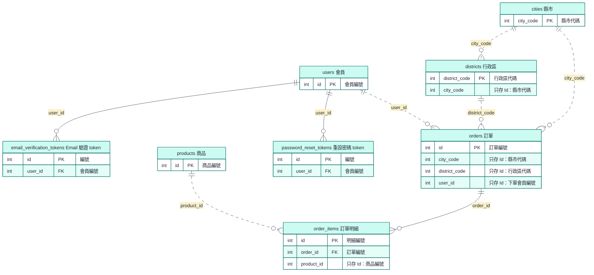

# 資料表

> 自動產生，請勿手動修改。改了 Entity 或 EF 設定後重新產生，指令見 [README「修改資料表結構」](../../README.md#修改資料表結構ef-migrations)。
> 資料來源是 `AppDbContext` 的 EF Core 模型，中文名稱與說明取自 Configuration 的 `HasComment()`；規範見 [database-design.md](../database-design.md)。

每張資料表一個檔：上半部自動產生（說明、相鄰的關聯、欄位），下半部的「說明」手寫，記錄聚合邊界、沒有外鍵或存快照的理由；業務規則寫在 [docs/modules](../modules/README.md)。

| 資料表 | 中文名稱 | 說明 |
|---|---|---|
| [cities](cities.md) | 縣市 | 結帳頁的縣市選項；代碼表 |
| [districts](districts.md) | 行政區 | 結帳頁的行政區選項，依縣市分組；代碼表 |
| [email_verification_tokens](email_verification_tokens.md) | Email 驗證 token | 註冊與重寄驗證信時發出，效期 24 小時 |
| [order_items](order_items.md) | 訂單明細 | 一筆訂單的每項商品；品名、單價、圖片是下單當時的快照 |
| [orders](orders.md) | 訂單 | 會員送出的訂單，金額由後端重算；寄送地址是下單當時的快照 |
| [password_reset_tokens](password_reset_tokens.md) | 重設密碼 token | 忘記密碼時發出，效期 30 分鐘、只能用一次 |
| [products](products.md) | 商品 | 前台販售的零食、泡麵、飲品 |
| [users](users.md) | 會員 | 註冊的帳號；Email 驗證完成才能登入 |

## 怎麼看關聯圖

| 看哪裡 | 意思 |
|---|---|
| 實線 | 資料庫外鍵：資料庫會檢查 Id 是否存在 |
| 虛線 | 只存 Id：沒有外鍵，資料庫不檢查；原因見 `LooseReferenceTests` 的允許清單 |
| 線端 `‖` | 恰好一筆 |
| 線端 `o│` | 零或一筆 |
| 線端 `o<`（鳥爪） | 零到多筆 |
| 線上文字 | 存 Id 的欄位 |

讀法：靠近哪個方框的符號，就是那一邊有幾筆。例如 `orders ‖──o< order_items`：一筆訂單有零到多筆明細，每筆明細屬於恰好一筆訂單。
方框只列主鍵與畫了線的欄位，所有欄位見各資料表的檔案。`created_by`、`modified_by` 也存會員編號，但每張表都有，不畫線。

## 關聯圖

