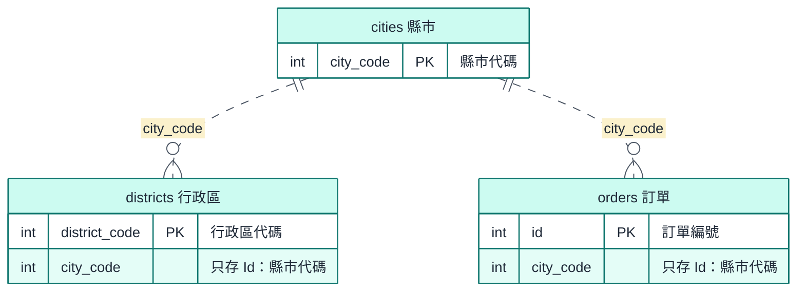

<!-- 自動產生開始：這段請勿手動修改，改了 Entity 或 EF 設定後重新產生（README「修改資料表結構」） -->
# cities 縣市

> 結帳頁的縣市選項；代碼表

實體：`City`。[← 回到資料表總表](README.md)

## 關聯

| 方向 | 資料表 | 欄位 | 種類 |
|---|---|---|---|
| 被參照 | [districts](districts.md) 行政區 | `districts.city_code` | 只存 Id |
| 被參照 | [orders](orders.md) 訂單 | `orders.city_code` | 只存 Id |

## 欄位

鍵：PK＝主鍵、FK＝資料庫外鍵、只存 Id＝存著其他資料表的主鍵，但沒有外鍵。索引：唯一＝唯一索引、有＝一般索引；主鍵本身就有索引，不另外標。

| 屬性 | 中文名稱 | 資料庫欄位 | 鍵 | 型別 | 必填 | 索引 | 說明 |
|---|---|---|---|---|---|---|---|
| CityCode | 縣市代碼 | `city_code` | PK | integer | 是 |  |  |
| CityName | 縣市名稱 | `city_name` |  | character varying(50) | 是 |  |  |

<!-- 自動產生結束：以下的「說明」手寫，重新產生不會蓋掉 -->

## 說明

<!-- 手寫：聚合邊界、為什麼沒有外鍵、為什麼存快照。業務規則寫在 docs/modules/，這裡用連結指過去。 -->
