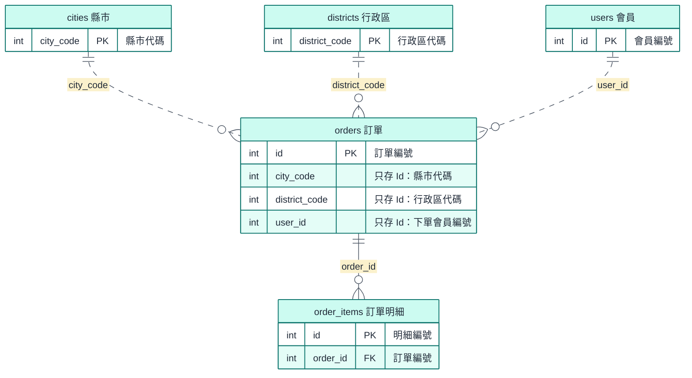

<!-- 自動產生開始：這段請勿手動修改，改了 Entity 或 EF 設定後重新產生（README「修改資料表結構」） -->
# orders 訂單

> 會員送出的訂單，金額由後端重算；寄送地址是下單當時的快照

實體：`Order`。[← 回到資料表總表](README.md)

## 關聯

| 方向 | 資料表 | 欄位 | 種類 |
|---|---|---|---|
| 參照 | [cities](cities.md) 縣市 | `orders.city_code` | 只存 Id |
| 參照 | [districts](districts.md) 行政區 | `orders.district_code` | 只存 Id |
| 參照 | [users](users.md) 會員 | `orders.user_id` | 只存 Id |
| 被參照 | [order_items](order_items.md) 訂單明細 | `order_items.order_id` | 外鍵 |

## 欄位

鍵：PK＝主鍵、FK＝資料庫外鍵、只存 Id＝存著其他資料表的主鍵，但沒有外鍵。索引：唯一＝唯一索引、有＝一般索引；主鍵本身就有索引，不另外標。

| 屬性 | 中文名稱 | 資料庫欄位 | 鍵 | 型別 | 必填 | 索引 | 說明 |
|---|---|---|---|---|---|---|---|
| Id | 訂單編號 | `id` | PK | integer | 是 |  |  |
| UserId | 下單會員編號 | `user_id` | 只存 Id → [users](users.md) | integer | 是 | 有 |  |
| Subtotal | 小計 | `subtotal` |  | integer | 是 |  | 明細小計加總 |
| DeliveryFee | 運費 | `delivery_fee` |  | integer | 是 |  | 小計滿 500 為 0，未滿為 60 |
| Total | 合計 | `total` |  | integer | 是 |  | 小計＋運費 |
| ContactName | 聯絡人姓名 | `contact_name` |  | character varying(100) | 是 |  |  |
| ContactPhone | 聯絡電話 | `contact_phone` |  | character varying(20) | 是 |  |  |
| DeliveryMethod | 配送方式 | `delivery_method` |  | integer | 是 |  | 尚未定義選項，前端固定送 1 |
| CityCode | 縣市代碼 | `city_code` | 只存 Id → [cities](cities.md) | integer | 是 |  |  |
| DistrictCode | 行政區代碼 | `district_code` | 只存 Id → [districts](districts.md) | integer | 是 |  |  |
| StreetAddress | 地址 | `street_address` |  | character varying(200) | 是 |  | 不含縣市、行政區 |
| DeliveryAddress | 寄送地址 | `delivery_address` |  | character varying(300) | 是 |  | 縣市＋行政區＋地址，下單當時的快照 |
| Memo | 備註 | `memo` |  | character varying(500) |  |  |  |
| CreatedOn | 建立時間 | `created_on` |  | timestamp with time zone | 是 | 有 | UTC |
| CreatedBy | 建立者 | `created_by` |  | integer |  |  | 會員編號；null 表示沒有登入身分，例：註冊、種子資料 |
| ModifiedOn | 最後修改時間 | `modified_on` |  | timestamp with time zone | 是 |  | UTC |
| ModifiedBy | 最後修改者 | `modified_by` |  | integer |  |  | 會員編號；null 表示沒有登入身分 |
| Status | 狀態 | `status` |  | smallint | 是 |  | 1 正常、9 已刪除；兼作軟刪除 |

<!-- 自動產生結束：以下的「說明」手寫，重新產生不會蓋掉 -->

## 說明

<!-- 手寫：聚合邊界、為什麼沒有外鍵、為什麼存快照。業務規則寫在 docs/modules/，這裡用連結指過去。 -->
