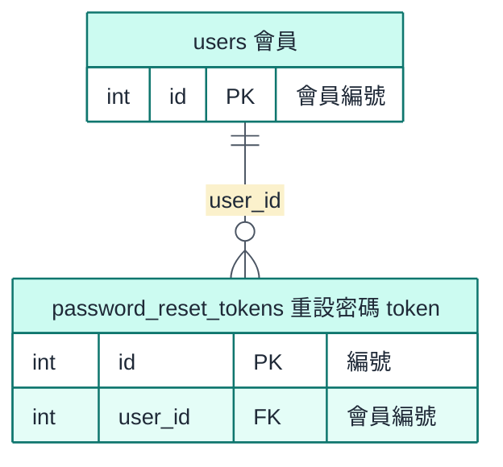

<!-- 自動產生開始：這段請勿手動修改，改了 Entity 或 EF 設定後重新產生（README「修改資料表結構」） -->
# password_reset_tokens 重設密碼 token

> 忘記密碼時發出，效期 30 分鐘、只能用一次

實體：`PasswordResetToken`。[← 回到資料表總表](README.md)

## 關聯

| 方向 | 資料表 | 欄位 | 種類 |
|---|---|---|---|
| 參照 | [users](users.md) 會員 | `password_reset_tokens.user_id` | 外鍵 |

## 欄位

鍵：PK＝主鍵、FK＝資料庫外鍵、只存 Id＝存著其他資料表的主鍵，但沒有外鍵。索引：唯一＝唯一索引、有＝一般索引；主鍵本身就有索引，不另外標。

| 屬性 | 中文名稱 | 資料庫欄位 | 鍵 | 型別 | 必填 | 索引 | 說明 |
|---|---|---|---|---|---|---|---|
| Id | 編號 | `id` | PK | integer | 是 |  |  |
| UserId | 會員編號 | `user_id` | FK → [users](users.md) | integer | 是 | 有 |  |
| TokenHash | token 雜湊值 | `token_hash` |  | character(64) | 是 | 唯一 | SHA-256，原文只出現在信中 |
| ExpiresOn | 到期時間 | `expires_on` |  | timestamp with time zone | 是 |  | UTC，發出後 30 分鐘 |
| UsedOn | 使用時間 | `used_on` |  | timestamp with time zone |  |  | UTC；null 表示還沒用過，只能用一次 |
| CreatedOn | 建立時間 | `created_on` |  | timestamp with time zone | 是 |  | UTC |
| CreatedBy | 建立者 | `created_by` |  | integer |  |  | 會員編號；null 表示沒有登入身分，例：註冊、種子資料 |
| ModifiedOn | 最後修改時間 | `modified_on` |  | timestamp with time zone | 是 |  | UTC |
| ModifiedBy | 最後修改者 | `modified_by` |  | integer |  |  | 會員編號；null 表示沒有登入身分 |
| Status | 狀態 | `status` |  | smallint | 是 |  | 1 正常、9 已刪除；兼作軟刪除 |

<!-- 自動產生結束：以下的「說明」手寫，重新產生不會蓋掉 -->

## 說明

<!-- 手寫：聚合邊界、為什麼沒有外鍵、為什麼存快照。業務規則寫在 docs/modules/，這裡用連結指過去。 -->
