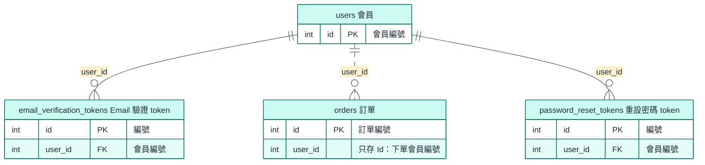

<!-- 自動產生開始：這段請勿手動修改，改了 Entity 或 EF 設定後重新產生（README「修改資料表結構」） -->
# users 會員

> 註冊的帳號；Email 驗證完成才能登入

實體：`User`。[← 回到資料表總表](README.md)

## 關聯

| 方向 | 資料表 | 欄位 | 種類 |
|---|---|---|---|
| 被參照 | [email_verification_tokens](email_verification_tokens.md) Email 驗證 token | `email_verification_tokens.user_id` | 外鍵 |
| 被參照 | [orders](orders.md) 訂單 | `orders.user_id` | 只存 Id |
| 被參照 | [password_reset_tokens](password_reset_tokens.md) 重設密碼 token | `password_reset_tokens.user_id` | 外鍵 |

## 欄位

鍵：PK＝主鍵、FK＝資料庫外鍵、只存 Id＝存著其他資料表的主鍵，但沒有外鍵。索引：唯一＝唯一索引、有＝一般索引；主鍵本身就有索引，不另外標。

| 屬性 | 中文名稱 | 資料庫欄位 | 鍵 | 型別 | 必填 | 索引 | 說明 |
|---|---|---|---|---|---|---|---|
| Id | 會員編號 | `id` | PK | integer | 是 |  |  |
| Name | 姓名 | `name` |  | character varying(100) | 是 |  |  |
| Email | Email | `email` |  | character varying(254) | 是 | 唯一 | 小寫正規化後儲存，不可重複 |
| PasswordHash | 密碼雜湊值 | `password_hash` |  | character varying(300) | 是 |  | 不存明碼 |
| Birthday | 生日 | `birthday` |  | date |  |  |  |
| Phone | 電話 | `phone` |  | character varying(20) |  |  |  |
| EmailVerifiedOn | Email 驗證完成時間 | `email_verified_on` |  | timestamp with time zone |  |  | UTC；null 表示尚未驗證，不能登入 |
| CreatedOn | 建立時間 | `created_on` |  | timestamp with time zone | 是 |  | UTC |
| CreatedBy | 建立者 | `created_by` |  | integer |  |  | 會員編號；null 表示沒有登入身分，例：註冊、種子資料 |
| ModifiedOn | 最後修改時間 | `modified_on` |  | timestamp with time zone | 是 |  | UTC |
| ModifiedBy | 最後修改者 | `modified_by` |  | integer |  |  | 會員編號；null 表示沒有登入身分 |
| Status | 狀態 | `status` |  | smallint | 是 |  | 1 正常、9 已刪除；兼作軟刪除 |

<!-- 自動產生結束：以下的「說明」手寫，重新產生不會蓋掉 -->

## 說明

<!-- 手寫：聚合邊界、為什麼沒有外鍵、為什麼存快照。業務規則寫在 docs/modules/，這裡用連結指過去。 -->
