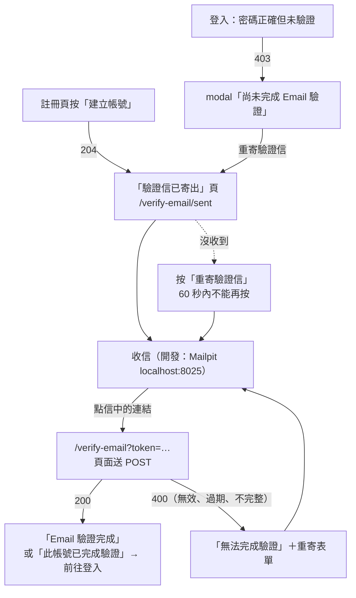
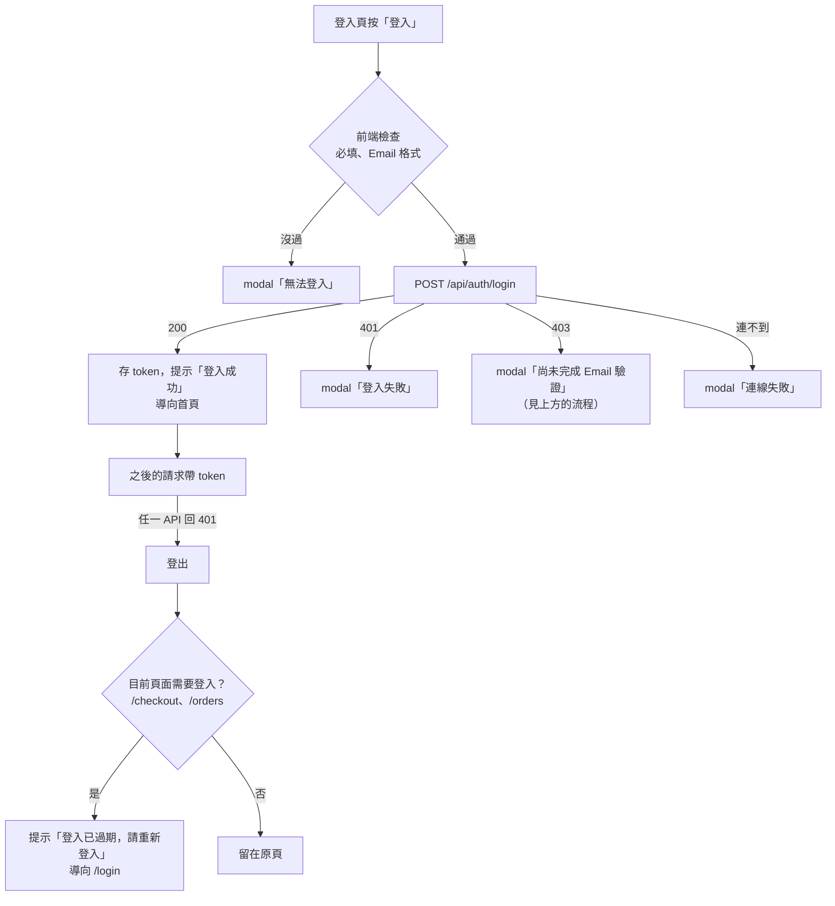

# Auth 會員

> 記錄現有程式的實際行為。改規則時，程式與本文件放在同一支 Pull Request 更新。
> 跨模組的流程見 [模組總覽](README.md)。

## 用例

| 用例 | 誰 | API | 畫面 |
|---|---|---|---|
| 註冊 | 訪客 | `POST /api/auth/register` | `RegisterView.vue`（`/register`） |
| Email 驗證 | 訪客 | `POST /api/auth/email-verifications` | `VerifyEmailView.vue`（`/verify-email?token=`，驗證信中的連結） |
| 重寄驗證信 | 訪客 | `POST /api/auth/verification-emails` | `VerificationSentView.vue`（`/verify-email/sent`）、驗證失敗時的 `VerifyEmailView.vue`、登入頁的 modal |
| 登入 | 訪客 | `POST /api/auth/login` | `LoginView.vue`（`/login`） |
| 登出 | 會員 | 沒有（前端清除 token） | header 的「登出」（`App.vue`） |
| 取得目前使用者 | 會員 | `GET /api/auth/me` 🔒 | 沒有畫面；`App.vue` 啟動時呼叫 |
| 修改密碼 | 會員 | `PUT /api/auth/password` 🔒 | 沒有畫面（前端 `AuthService.changePassword` 已寫好，但沒有地方呼叫） |

🔒 = 需要 JWT，沒有或失效時回 401。
後端：[AuthEndpoints.cs](../../src/Konbini.Api/Features/Auth/Endpoints/AuthEndpoints.cs)、
[Commands/](../../src/Konbini.Api/Features/Auth/Commands/)、
[PasswordPolicy.cs](../../src/Konbini.Api/Features/Auth/Models/PasswordPolicy.cs)、
[EmailVerificationToken.cs](../../src/Konbini.Api/Features/Auth/Models/EmailVerificationToken.cs)。
業務決策：[decisions/Auth.md](decisions/Auth.md)。
前端：[features/Auth/](../../src/Konbini.Client/src/features/Auth/)。

## 流程：註冊與 Email 驗證

## 流程：登入與 token 失效

## 業務規則

### 註冊

後端會檢查所有欄位，錯誤一次回傳；同一個 key 只回一則，依表格順序取第一個不符合的。
前端在送出前也有自己的檢查（見「前端行為」），兩邊的訊息措辭不完全相同。
姓、名、手機先去掉頭尾空白，Email 先去頭尾空白並轉小寫（`User.NormalizeEmail`），再檢查必填、長度與格式；
只有空白算沒填。

| key | 規則 | 後端訊息 | 前端訊息 |
|---|---|---|---|
| `lastName` | 必填 | 請輸入姓氏 | 請輸入姓氏 |
| `firstName` | 必填 | 請輸入名字 | 請輸入名字 |
| `name` | 姓＋名合計不超過 100 個字元（`User.NameMaxLength`） | 姓名合計不可超過 100 個字元 | （不檢查） |
| `email` | 必填 | 請填寫Email | 請輸入 Email |
| `email` | 不超過 254 個字元（`User.EmailMaxLength`） | Email不可超過 254 個字元 | （不檢查） |
| `email` | 格式：`名稱@網域.後綴`，不可有空白、只能有一個 `@` | Email格式不正確 | Email 格式不正確 |
| `email` | 沒有被註冊過（轉小寫、去前後空白後比對） | 此Email已註冊過 | （不檢查） |
| `password` | 見下方「密碼規則」 | 見下方 | 請輸入密碼；密碼還不符合規則：{不符合的條件，以「、」分隔} |
| `confirmPassword` | 與密碼相同 | 密碼與確認密碼不一致，請重新輸入 | 請再輸入一次密碼；密碼與確認密碼不一致，請重新輸入 |
| `phoneNumber` | 必填 | 請填寫手機號碼 | 請輸入手機號碼 |
| `phoneNumber` | `09` 開頭、共 10 碼數字 | 手機號碼格式不正確 | 手機號碼為 09 開頭共 10 碼 |
| `birthday` | 年、月、日都要選（後端以 0 表示沒選） | 請選擇完整的出生年月日 | 請選擇年／請選擇月／請選擇日（key 為 `year`、`month`、`day`） |
| `birthday` | 日期要存在（例：沒有 2 月 30 日）；沒有年份範圍 | 出生日期不正確 | （日選單依年月列出天數，選不到不存在的日期） |

儲存與回應：

- 姓、名、手機去前後空白後儲存，姓名存成「姓＋名」直接相連；Email 轉小寫、去前後空白後儲存；
  密碼只存雜湊值（`PasswordHasher`）。
- 兩個請求同時用同一個 Email 註冊時，後到的那個由資料庫的唯一索引擋下，同樣回「此Email已註冊過」。
- 已軟刪除帳號的 Email 不能再註冊（[CLAUDE.md §3](../../CLAUDE.md#3-資料與機密)「稽核欄位與 EF Migrations」）。
- 成功回 204，沒有內容；失敗回 400 ProblemDetails，`errors` 列出每個不符合的欄位（[api-conventions「回應格式」](../api-conventions.md#回應格式)）。
- 新帳號是「未驗證」（`email_verified_on` 是 null），寫入後寄出驗證信（見下方「Email 驗證」）。
  寄不出去時帳號照樣建立、照樣回 204，API 記 error log；使用者在「驗證信已寄出」頁重寄。

### 密碼規則（`PasswordPolicy`）

註冊與修改密碼共用，依序檢查，只回第一條不符合的：

| 順序 | 規則 | 錯誤訊息原文 |
|---|---|---|
| 1 | 至少 8 個字元（只有空白也算不符合） | 密碼至少需要 8 個字元 |
| 2 | 不超過 20 個字元 | 密碼不可超過 20 個字元 |
| 3 | 不可有空白 | 密碼不可包含空白 |
| 4 | 要有大寫英文字母、小寫英文字母、數字與半形符號各至少一個 | 密碼需包含大寫英文字母、小寫英文字母、數字與符號 |

- 半形符號是鍵盤上 `!@#$%` 這類 ASCII 符號；中文與全形符號不算。
- 前端 [passwordRules.ts](../../src/Konbini.Client/src/features/Auth/constants/passwordRules.ts) 有同一份規則，
  用來顯示強度條、在送出時列出不符合的條件；改規則時兩邊一起改（[api-conventions「驗證」](../api-conventions.md#驗證)）。
- 規則與 NIST 建議的差異見 [CLAUDE.md §6](../../CLAUDE.md#6-分支與-cicd)「密碼長度上限」那一列。

### 登入

| 情況 | 狀態碼 | 回應 |
|---|---|---|
| Email 或密碼是空的 | 400 | `general`：請輸入帳號與密碼 |
| 帳號不存在（含已軟刪除），或密碼錯誤 | 401 | `general`：帳號或密碼錯誤 |
| 密碼正確，但還沒完成 Email 驗證 | 403 | `general`：此帳號尚未完成 Email 驗證，請到信箱點驗證連結 |
| 成功 | 200 | `{ "token": "…", "user": { "id", "name", "email", "phone" } }` |

- 帳號不存在與密碼錯誤回同一則訊息，避免從回應判斷哪些 Email 註冊過。
- 密碼正確才檢查驗證狀態：密碼錯誤的未驗證帳號照樣回 401，不知道密碼的人看不出帳號驗證了沒有。
- 2026-11-12 Email 驗證上線前就存在的帳號視為已驗證（Migration 填入當時的時間）。
- Email 轉小寫、去前後空白後比對，所以大小寫不同也能登入。
- 登入不檢查密碼規則：以前註冊、不符合現行規則的帳號仍然登得進去。
- 沒有登入次數限制（CLAUDE.md §6「明確不做」的登入速率限制）。
- token 是 JWT，效期 8 小時，內容只有使用者 Id（`sub`）。

### Email 驗證

決定與理由見 [DD-AUT-001](decisions/Auth.md#dd-aut-001email-驗證的規則2026-11-12使用者決定claudemd-6email-驗證)。

- **驗證信**：主旨「【Konbini】請驗證您的 Email」，寄件者 `Konbini <no-reply@konbini.test>`。
  連結是 `{App:ClientBaseUrl}/verify-email?token=…`，**24 小時**內有效（`EmailVerificationToken.Lifetime`）。
- **token**：256 位元亂數（base64url，43 個字元），資料庫只存 SHA-256 雜湊值，只能用一次。
- **驗證**（`POST /api/auth/email-verifications`，body `{ "token": "…" }`）：

| 順序 | 情況 | 狀態碼 | 回應 |
|---|---|---|---|
| 1 | token 是空的 | 400 | `token`：驗證連結不完整，請從信中重新點選連結 |
| 2 | 找不到（打錯、被新的驗證信取代） | 400 | `token`：驗證連結無效，請使用最新一封驗證信中的連結，或重新寄送驗證信 |
| 3 | 已經用過（不看效期） | 200 | `{ "alreadyVerified": true }` |
| 4 | 超過效期（剛好到期也算） | 400 | `token`：驗證連結已過期，請重新寄送驗證信 |
| 5 | 成功：帳號標為已驗證、token 標為已使用 | 200 | `{ "alreadyVerified": false }` |

- **重寄**（`POST /api/auth/verification-emails`，body `{ "email": "…" }`）：

| 情況 | 狀態碼 | 回應 |
|---|---|---|
| Email 是空的 | 400 | `email`：請輸入 Email |
| 超過 254 個字元，或格式不對 | 400 | `email`：Email 格式不正確 |
| 帳號不存在、已經驗證、距離上一封不到 **60 秒**（`EmailVerificationToken.ResendCooldown`） | 204 | 沒有內容，不寄信 |
| 其他：舊的未使用 token 全部刪除，產生新的並寄出 | 204 | 沒有內容 |
| 寄不出去（SMTP 連不上、超過 10 秒） | 500 | `title`：伺服器發生錯誤，請稍後再試。 |

- 重寄的回應一致，看不出哪些 Email 註冊過；畫面上一律顯示「如果這個 Email 已註冊且尚未驗證，我們已寄出驗證信」。
- Email 與註冊相同：先去頭尾空白、轉小寫，再檢查格式與比對。

### 目前使用者

- `GET /api/auth/me` 回傳 `{ id, name, email, phone }`；token 有效但使用者已不存在時回 404，`general`：找不到使用者。

### 修改密碼

- 需要登入。依序檢查，遇到第一個錯誤就回傳，不會一次列出：

| 順序 | 狀態碼 | key | 規則 | 錯誤訊息原文 |
|---|---|---|---|---|
| 1 | 404 | `general` | 使用者存在 | 找不到使用者 |
| 2 | 400 | `currentPassword` | 必填（沒送或只有空白都算沒填） | 請輸入目前密碼 |
| 3 | 400 | `currentPassword` | 目前密碼正確 | 目前密碼不正確 |
| 4 | 400 | `newPassword` | 符合密碼規則 | 見「密碼規則」 |
| 5 | 400 | `newPassword` | 與目前密碼不同 | 新密碼不可與目前密碼相同 |

- 沒有「確認新密碼」欄位。
- 目前密碼錯誤回 400、不回 401：前端收到 401 會登出（[CLAUDE.md §2](../../CLAUDE.md#2-架構決策)「用例結果」）。
- 成功回 204，沒有內容。改密碼後，已發出的 token 在效期內仍然有效。

## 前端行為

- **表單錯誤**：登入、註冊與重寄驗證信都只在按送出時檢查。沒過或後端回了錯誤，用 modal 列出，同時標在欄位下方；
  關掉 modal 後游標移到第一個出錯的欄位，修改某一欄時清掉那一欄的錯誤
  （[CLAUDE.md §2](../../CLAUDE.md#2-架構決策)「表單錯誤」、[ui-guidelines「表單頁」](../ui-guidelines.md#表單頁)）。
- 連不到 API（沒有回應、502–504、代理回的空白 500）時顯示 modal「連線失敗」。
- **註冊頁**：所有欄位必填，頁首說明「註冊後到信箱完成驗證，就能用 Email 登入。」。密碼欄下方有五格強度條與規則提示；出生年可選今年往前 100 年（含今年）。
  成功時提示「註冊成功，請到信箱完成驗證」，導向 `/verify-email/sent`（Email 以 history state 傳遞，不放網址）。
- **登入頁**：只檢查必填與 Email 格式。401 時 modal 標題「登入失敗」，內容是後端的訊息加上
  「請確認 Email 與密碼後再試一次。」。403 時 modal 標題「尚未完成 Email 驗證」，主按鈕「重寄驗證信」、次按鈕「關閉」；
  按重寄後寄出驗證信並導向 `/verify-email/sent`。成功時提示「登入成功」，一律導向首頁。
- **驗證信已寄出（`/verify-email/sent`）**：從註冊或登入頁過來時，顯示「驗證信已寄出」與寄到哪個 Email，
  重寄按鈕一開始就倒數 60 秒（不顯示下方的重寄提示）；直接開網址時標題是「重寄驗證信」，Email 欄是空的。
  重寄成功後顯示「如果這個 Email 已註冊且尚未驗證，我們已寄出驗證信，請在 24 小時內點信中的連結。」並倒數 60 秒
  （後端在冷卻時間內不寄信、但回應相同）。倒數只存在頁面上，重新整理後就沒有了。
- **驗證結果（`/verify-email?token=…`）**：進頁面後先把 token 從網址拿掉，再送出驗證，顯示「正在驗證…」。
  成功顯示「Email 驗證完成」或「此帳號已完成驗證」與「前往登入」；400 顯示「無法完成驗證」、後端的訊息與重寄表單；
  連不到 API 顯示「暫時無法連線到伺服器」與「重新驗證」。網址上沒有 token 時顯示「驗證連結不完整」。
  驗證完成後不自動登入。重新整理頁面時 token 已經不在網址上，會顯示「驗證連結不完整」。
- **token 保存**：存在 localStorage（鍵 `konbini.token`），每個 API 請求自動帶上。
- **啟動時**：有 token 就呼叫 `/api/auth/me` 取使用者資料。回 404 就登出；網路錯誤或 500 保留 token。
- **登出**：只清掉瀏覽器的 token 與使用者資料，沒有呼叫 API；購物車不受影響。
- **header**：有 token 時顯示「登出」，沒有時顯示「登入」；頁尾在沒有 token 時顯示「建立帳號」。

## 尚未實作

都在 [CLAUDE.md §6](../../CLAUDE.md#6-分支與-cicd)：

- 「忘記密碼」：沿用 Email 驗證的 `IEmailSender` 與 token 的做法。
- 清除長期未驗證的帳號、改 Email 後重新驗證（[DD-AUT-001](decisions/Auth.md) 的「未做」）。
- 「圖形驗證碼」、「第三方登入（Google、LINE）」。
- 「refresh token」：登出、改密碼後讓舊 token 提早作廢。
- 修改密碼的畫面：§6 沒有列；[CLAUDE.md §2](../../CLAUDE.md#2-架構決策)「表單錯誤」提到有改密碼表單時要再檢視一次錯誤呈現方式。
