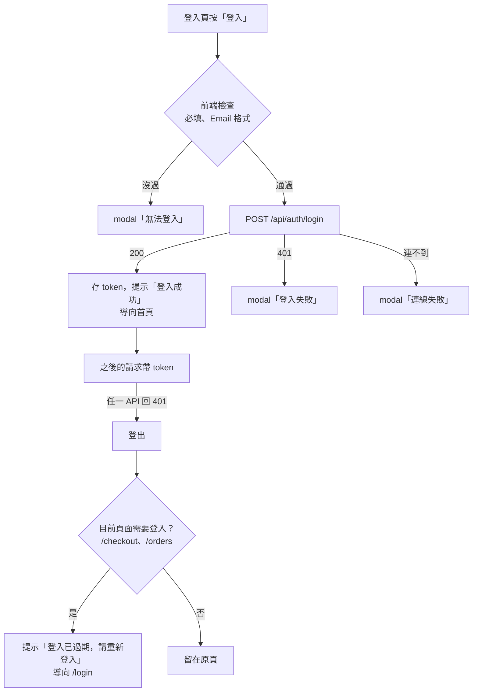

# Auth 會員

> 記錄現有程式的實際行為。改規則時，程式與本文件放在同一支 Pull Request 更新。
> 跨模組的流程見 [模組總覽](README.md)。

## 用例

| 用例 | 誰 | API | 畫面 |
|---|---|---|---|
| 註冊 | 訪客 | `POST /api/auth/register` | `RegisterView.vue`（`/register`） |
| 登入 | 訪客 | `POST /api/auth/login` | `LoginView.vue`（`/login`） |
| 登出 | 會員 | 沒有（前端清除 token） | header 的「登出」（`App.vue`） |
| 取得目前使用者 | 會員 | `GET /api/auth/me` 🔒 | 沒有畫面；`App.vue` 啟動時呼叫 |
| 修改密碼 | 會員 | `PUT /api/auth/password` 🔒 | 沒有畫面（前端 `AuthService.changePassword` 已寫好，但沒有地方呼叫） |

🔒 = 需要 JWT，沒有或失效時回 401。
後端：[AuthEndpoints.cs](../../src/Konbini.Api/Features/Auth/Endpoints/AuthEndpoints.cs)、
[Commands/](../../src/Konbini.Api/Features/Auth/Commands/)、
[PasswordPolicy.cs](../../src/Konbini.Api/Features/Auth/Models/PasswordPolicy.cs)。
前端：[features/Auth/](../../src/Konbini.Client/src/features/Auth/)。

## 流程：登入與 token 失效

## 業務規則

### 註冊

後端會檢查所有欄位，錯誤一次回傳；同一個 key 只回一則，依表格順序取第一個不符合的。
前端在送出前也有自己的檢查（見「前端行為」），兩邊的訊息措辭不完全相同。

| key | 規則 | 後端訊息 | 前端訊息 |
|---|---|---|---|
| `lastName` | 必填 | 請輸入姓氏 | 請輸入姓氏 |
| `firstName` | 必填 | 請輸入名字 | 請輸入名字 |
| `name` | 姓＋名合計不超過 100 個字元（`User.NameMaxLength`） | 姓名合計不可超過 100 個字元 | （不檢查） |
| `email` | 必填 | 請填寫Email | 請輸入 Email |
| `email` | 不超過 254 個字元（`User.EmailMaxLength`） | Email不可超過 254 個字元 | （不檢查） |
| `email` | 格式：`名稱@網域.後綴`，不可有空白、只能有一個 `@` | Email格式不正確 | Email 格式不正確 |
| `email` | 沒有被註冊過（轉小寫、去前後空白後比對） | 此Email已註冊過 | （不檢查） |
| `password` | 見下方「密碼規則」 | 見下方 | 請輸入密碼；密碼還不符合規則：{不符合的條件，以「、」分隔} |
| `confirmPassword` | 與密碼相同 | 密碼與確認密碼不一致，請重新輸入 | 請再輸入一次密碼；密碼與確認密碼不一致，請重新輸入 |
| `phoneNumber` | 必填 | 請填寫手機號碼 | 請輸入手機號碼 |
| `phoneNumber` | `09` 開頭、共 10 碼數字 | 手機號碼格式不正確 | 手機號碼為 09 開頭共 10 碼 |
| `birthday` | 年、月、日都要選（後端以 0 表示沒選） | 請選擇完整的出生年月日 | 請選擇年／請選擇月／請選擇日（key 為 `year`、`month`、`day`） |
| `birthday` | 日期要存在（例：沒有 2 月 30 日）；沒有年份範圍 | 出生日期不正確 | （日選單依年月列出天數，選不到不存在的日期） |

儲存與回應：

- 姓名存成「姓＋名」直接相連；Email 轉小寫、去前後空白後儲存；密碼只存雜湊值（`PasswordHasher`）。
- 兩個請求同時用同一個 Email 註冊時，後到的那個由資料庫的唯一索引擋下，同樣回「此Email已註冊過」。
- 已軟刪除帳號的 Email 不能再註冊（[CLAUDE.md §3](../../CLAUDE.md#3-資料與機密)「稽核欄位與 EF Migrations」）。
- 成功回 204，沒有內容；失敗回 400 ProblemDetails，`errors` 列出每個不符合的欄位（[api-conventions「回應格式」](../api-conventions.md#回應格式)）。

### 密碼規則（`PasswordPolicy`）

註冊與修改密碼共用，依序檢查，只回第一條不符合的：

| 順序 | 規則 | 錯誤訊息原文 |
|---|---|---|
| 1 | 至少 8 個字元（只有空白也算不符合） | 密碼至少需要 8 個字元 |
| 2 | 不超過 20 個字元 | 密碼不可超過 20 個字元 |
| 3 | 不可有空白 | 密碼不可包含空白 |
| 4 | 要有大寫英文字母、小寫英文字母、數字與半形符號各至少一個 | 密碼需包含大寫英文字母、小寫英文字母、數字與符號 |

- 半形符號是鍵盤上 `!@#$%` 這類 ASCII 符號；中文與全形符號不算。
- 前端 [passwordRules.ts](../../src/Konbini.Client/src/features/Auth/constants/passwordRules.ts) 有同一份規則，
  用來顯示強度條、在送出時列出不符合的條件；改規則時兩邊一起改（[api-conventions「驗證」](../api-conventions.md#驗證)）。
- 規則與 NIST 建議的差異見 [CLAUDE.md §6](../../CLAUDE.md#6-分支與-cicd)「密碼長度上限」那一列。

### 登入

| 情況 | 狀態碼 | 回應 |
|---|---|---|
| Email 或密碼是空的 | 400 | `general`：請輸入帳號與密碼 |
| 帳號不存在（含已軟刪除），或密碼錯誤 | 401 | `general`：帳號或密碼錯誤 |
| 成功 | 200 | `{ "token": "…", "user": { "id", "name", "email", "phone" } }` |

- 帳號不存在與密碼錯誤回同一則訊息，避免從回應判斷哪些 Email 註冊過。
- Email 轉小寫、去前後空白後比對，所以大小寫不同也能登入。
- 登入不檢查密碼規則：以前註冊、不符合現行規則的帳號仍然登得進去。
- 沒有登入次數限制（CLAUDE.md §6「明確不做」的登入速率限制）。
- token 是 JWT，效期 8 小時，內容只有使用者 Id（`sub`）。

### 目前使用者

- `GET /api/auth/me` 回傳 `{ id, name, email, phone }`；token 有效但使用者已不存在時回 404，`general`：找不到使用者。

### 修改密碼

- 需要登入。依序檢查，遇到第一個錯誤就回傳，不會一次列出：

| 順序 | 狀態碼 | key | 規則 | 錯誤訊息原文 |
|---|---|---|---|---|
| 1 | 404 | `general` | 使用者存在 | 找不到使用者 |
| 2 | 400 | `currentPassword` | 目前密碼正確 | 目前密碼不正確 |
| 3 | 400 | `newPassword` | 符合密碼規則 | 見「密碼規則」 |

- 沒有「確認新密碼」欄位，也不檢查新密碼是否和舊密碼相同。
- 目前密碼錯誤回 400、不回 401：前端收到 401 會登出（[CLAUDE.md §2](../../CLAUDE.md#2-架構決策)「用例結果」）。
- 成功回 204，沒有內容。改密碼後，已發出的 token 在效期內仍然有效。

## 前端行為

- **表單錯誤**：登入與註冊都只在按送出時檢查。沒過或後端回了錯誤，用 modal 列出，同時標在欄位下方；
  關掉 modal 後游標移到第一個出錯的欄位，修改某一欄時清掉那一欄的錯誤
  （[CLAUDE.md §2](../../CLAUDE.md#2-架構決策)「表單錯誤」、[ui-guidelines「表單頁」](../ui-guidelines.md#表單頁)）。
- 連不到 API（沒有回應、502–504、代理回的空白 500）時顯示 modal「連線失敗」。
- **註冊頁**：所有欄位必填。密碼欄下方有五格強度條與規則提示；出生年可選今年往前 100 年（含今年）。
  成功時提示「註冊成功，請登入」，導向 `/login` 並預先填好 Email（Email 以 history state 傳遞，不放網址）。
- **登入頁**：只檢查必填與 Email 格式。401 時 modal 標題「登入失敗」，內容是後端的訊息加上
  「請確認 Email 與密碼後再試一次。」。成功時提示「登入成功」，一律導向首頁。
- **token 保存**：存在 localStorage（鍵 `konbini.token`），每個 API 請求自動帶上。
- **啟動時**：有 token 就呼叫 `/api/auth/me` 取使用者資料。回 404 就登出；網路錯誤或 500 保留 token。
- **登出**：只清掉瀏覽器的 token 與使用者資料，沒有呼叫 API；購物車不受影響。
- **header**：有 token 時顯示「登出」，沒有時顯示「登入」；頁尾在沒有 token 時顯示「建立帳號」。

## 尚未實作

都在 [CLAUDE.md §6](../../CLAUDE.md#6-分支與-cicd)：

- 「Email 驗證（可延伸到忘記密碼）」：開工前已決定的事項會寫成 `decisions/Auth.md` 的第一則決策（見 [模組總覽「業務決策紀錄」](README.md#4-業務決策紀錄)）。
- 「圖形驗證碼」、「第三方登入（Google、LINE）」。
- 「refresh token」：登出、改密碼後讓舊 token 提早作廢。
- 修改密碼的畫面：§6 沒有列；[CLAUDE.md §2](../../CLAUDE.md#2-架構決策)「表單錯誤」提到有改密碼表單時要再檢視一次錯誤呈現方式。
