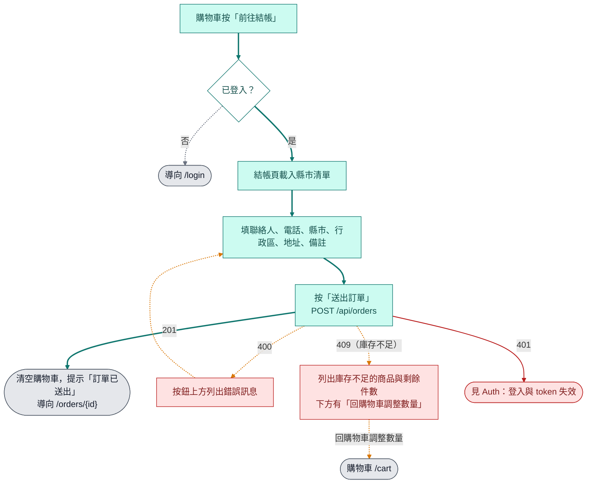

# Orders 訂單

> 記錄現有程式的實際行為。改規則時，程式與本文件放在同一支 Pull Request 更新。
> 跨模組的流程見 [模組總覽](README.md)。

## 用例

| 用例 | 誰 | API | 畫面 |
|---|---|---|---|
| 下單 | 已登入會員 | `POST /api/orders` 🔒 | `CheckoutView.vue`（`/checkout`） |
| 查看我的訂單 | 已登入會員 | `GET /api/orders?page=&pageSize=` 🔒 | `OrdersView.vue`（`/orders`） |
| 查看訂單明細 | 已登入會員 | `GET /api/orders/{id}` 🔒 | `OrderDetailView.vue`（`/orders/:id`） |

🔒 = 需要 JWT，沒有或失效時回 401。
後端：[OrderEndpoints.cs](../../src/Konbini.Api/Features/Orders/Endpoints/OrderEndpoints.cs)、
[CreateOrderCommand.cs](../../src/Konbini.Api/Features/Orders/Commands/CreateOrderCommand.cs)、
[OrderRepository.cs](../../src/Konbini.Api/Features/Orders/Repositories/OrderRepository.cs)。
前端：[features/Orders/](../../src/Konbini.Client/src/features/Orders/)。

## 流程：結帳

後端的檢查分三段：先檢查所有欄位、錯誤一次回傳（400）；欄位都通過後查商品是否存在（400）；最後檢查庫存（409）。

## 業務規則

### 下單的欄位檢查

errors 的 key 是欄位名稱；同一個 key 只回一則，依表格順序取第一個不符合的。
聯絡人、電話、地址、備註先去掉頭尾空白再檢查與儲存，長度看處理後的值；只有空白的備註存成 null。

| key | 規則 | 錯誤訊息原文 |
|---|---|---|
| `items` | 至少 1 項 | 購物車是空的 |
| `items` | 不超過 50 筆，同一個商品分多筆送來也各算一筆（`Order.MaxItems`） | 購物車最多 50 項商品 |
| `items` | 每一筆都要有內容（不是 `null`） | 商品資料不正確 |
| `items` | 每項數量大於 0 | 商品數量必須大於 0 |
| `items` | 每項數量不超過 99；同一個商品分多筆送來時看合計（`OrderItem.MaxQuantity`） | 每項商品數量不可超過 99 件 |
| `contactName` | 必填（只有空白也算沒填） | 請填寫聯絡人姓名 |
| `contactName` | 不超過 100 個字元（`Order.ContactNameMaxLength`） | 聯絡人姓名不可超過 100 個字元 |
| `contactPhone` | 必填；不檢查格式 | 請填寫聯絡電話 |
| `contactPhone` | 不超過 20 個字元（`Order.ContactPhoneMaxLength`） | 聯絡電話不可超過 20 個字元 |
| `streetAddress` | 必填 | 請填寫地址 |
| `streetAddress` | 不超過 200 個字元（`Order.StreetAddressMaxLength`） | 地址不可超過 200 個字元 |
| `memo` | 選填，不超過 500 個字元（`Order.MemoMaxLength`） | 備註不可超過 500 個字元 |
| `address` | 縣市代碼存在，且行政區屬於該縣市（見 [Addresses](Addresses.md)） | 縣市或行政區不正確 |

- `deliveryMethod`（配送方式）不檢查，收到什麼就存什麼。
- 欄位都通過後，若有商品 Id 不存在（含已軟刪除的商品），回 `items`：「下列商品不存在：{Id, Id}」，列出的是商品 Id。

### 金額

- 同一個商品分多筆送來時，合併成一筆明細。
- 單價取資料庫現價，不採用前端送來的任何金額（請求裡也沒有金額欄位）。
- 明細小計 = 單價 × 數量；訂單小計 = 各明細小計加總。
- 運費：小計滿 500 為 0，未滿為 60（[Pricing.cs](../../src/Konbini.Api/Features/Orders/Models/Pricing.cs)）。
- 合計 = 小計＋運費。
- 明細保存下單當時的商品名稱、單價、圖片，之後商品改價或改名不影響歷史訂單
  （[database-design「訂單快照」](../database-design.md#訂單快照)）。
- 寄送地址 = 縣市名稱＋行政區名稱＋地址，三段直接相連（例：「台北市中正區重慶南路一段 122 號」）。
- 下單的使用者取自 token，不接受前端傳來的使用者 Id。

### 庫存

- 欄位與商品都通過後才檢查庫存；同一個商品分多筆送來時看合計。
- 任何一項不夠就回 409，`items`：「下列商品庫存不足：{品名}（剩 N 件）、{品名}（已售完）」，依送來的順序列出；
  整筆訂單不成立，庫存不變。
- 庫存足夠時，扣庫存與建立訂單在同一個交易內。同時下單由資料庫的條件式更新判斷，不會超賣；
  檢查之後才被別人買走時一樣回 409，剩餘件數是重新讀出的值；這段時間商品被刪除時回 400「下列商品不存在」。
- 決策與理由見 [DD-ORD-002](decisions/Orders.md#dd-ord-002庫存與扣庫存2026-11-18使用者決定claudemd-6庫存欄位與扣庫存交易)；
  交易的寫法見 [database-design「交易」](../database-design.md#交易)。

### 回應

| 情況 | 狀態碼 | 內容 |
|---|---|---|
| 成功 | 201 | Location 為 `/api/orders/{id}`；body 為 `{ "id": 123 }` |
| 檢查沒過、商品不存在 | 400 | ProblemDetails，`errors` 列出每個不符合的欄位 |
| 庫存不足 | 409 | ProblemDetails，`errors.items` 列出庫存不足的商品 |
| 沒有登入或 token 失效 | 401 | 沒有內容 |

### 我的訂單

- 只列出自己的訂單，依建立時間新到舊（時間相同再依 Id），含明細，明細依下單時送來的順序排列；分頁規則見 [模組總覽「共同規則」](README.md#2-模組關係)。
- 每筆訂單回傳 `id`、`subtotal`、`deliveryFee`、`total`、`contactName`、`contactPhone`、`deliveryAddress`、
  `memo`、`createdAt`、`items`；沒有配送方式、縣市與行政區代碼。

### 訂單明細

- 只能看自己的訂單。不存在、不是自己的、已軟刪除的訂單都回 404 ProblemDetails，`general`：找不到訂單
  （不回 403，不讓人分辨訂單是否存在）。
- 回傳內容與「我的訂單」中的一筆相同。
- 決策與理由見 [DD-ORD-001](decisions/Orders.md#dd-ord-001訂單明細2026-11-16使用者決定claudemd-6api-回應與-docsapi-conventionsmd-的落差)。

## 前端行為

- **進入結帳頁、我的訂單、訂單明細**：沒有 token 時導向 `/login?redirect=<原本的網址>`，登入成功後回到原本的頁面（見 [Auth](Auth.md)）。
- 這三頁在路由上標記 `requiresAuth`：停留在頁面時 token 失效（API 回 401），會提示「登入已過期，請重新登入」並導向 `/login`。
- **結帳頁**：
  - 購物車是空的時顯示「購物車是空的。」，不顯示表單。
  - 沒有配送方式的欄位，固定送 `deliveryMethod: 1`。
  - 選了縣市才載入該縣市的行政區，並清空已選的行政區。
  - 顯示「合計 NT$ X（實際金額以後端計算為準）」，X 是購物車的預覽金額。
  - 前端不檢查欄位，按「送出訂單」後由後端檢查；送出中按鈕停用。
  - 400 時把後端回傳的每則錯誤列在按鈕上方；沒有 errors 的失敗（連不到伺服器、500）顯示「訂單送出失敗，請稍後再試」。
  - 409（庫存不足）時同樣列出後端的訊息，下方多一個「回購物車調整數量」連結；購物車不會自動調整。
  - 成功時清空購物車，提示「訂單已送出」，導向該筆訂單的明細頁。
- **我的訂單**：載入中顯示「載入中…」；載入失敗顯示「暫時看不到訂單」與「重新載入」；沒有訂單時顯示「還沒有任何訂單。」。
  每張訂單顯示「訂單 #Id」（連到明細頁）、建立時間（台灣時間，格式 `2026/11/16 14:05`）、每項明細「品名 × 數量　NT$ 小計」、
  寄送地址、合計與「查看明細」按鈕；頁碼放在網址的 `?page=`。
- **訂單明細**：
  - 依序顯示：
    - 「‹ 我的訂單」返回連結
    - 「訂單 #Id」與建立時間
    - 商品明細：圖片、品名（連到商品頁）、單價 × 數量、小計
    - 小計、運費、合計
    - 收件資訊：聯絡人、電話、寄送地址；有備註才顯示備註
  - 寬螢幕時，商品明細在左，金額與收件資訊在右；手機上由上往下排列。
  - 載入中顯示轉圈。
  - 找不到（含網址的 Id 不是正整數）時顯示「找不到這筆訂單」與「回我的訂單」按鈕。
  - 載入失敗時顯示「暫時看不到這筆訂單」與「重新載入」按鈕。
- header 的「我的訂單」在取得使用者資料後才出現；頁尾的「查詢訂單」一律顯示。

## 尚未實作

- 結帳頁、我的訂單的 UI 規範（Element Plus、四種畫面狀態、`formatMoney`）：見 CLAUDE.md §6「前端 feature 頁面遷移到 UI 規範」。
- 訂單狀態、取消訂單（含回補庫存）：訂單與履約的下一支 Pull Request。
- 付款、配送方式的選項：§6 沒有列。
