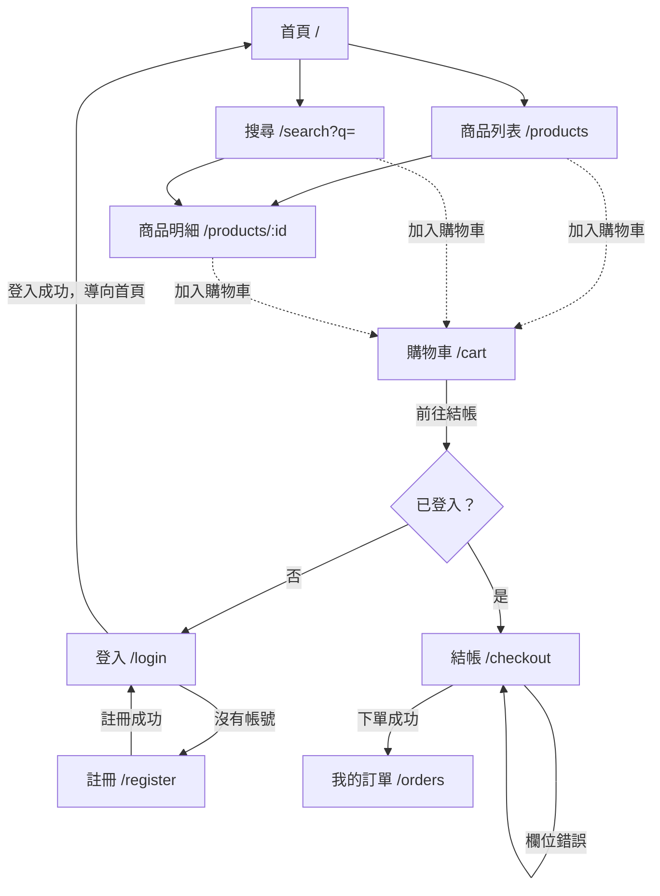

# 業務模組總覽

更新日期：2026-11-12。新增模組、模組之間多了呼叫關係時，同步更新本文件。

這組文件記錄**各模組現有程式的實際行為**：誰能做什麼、規則與錯誤訊息原文、流程、對應的 API 與畫面。

- 改了業務規則，程式與模組文件放在同一支 Pull Request 更新；文件與程式不一致時，以程式為準並修正文件。
- 其他文件的分工：開發步驟與指令寫 [README](../../README.md)；架構與技術決策的理由寫 [CLAUDE.md](../../CLAUDE.md)；
  API、資料庫、畫面的通用規範寫 [api-conventions](../api-conventions.md)、[database-design](../database-design.md)、
  [ui-guidelines](../ui-guidelines.md)。
- 資料夾叫 `modules/`，也不做限界上下文、聚合根這類 DDD 分析：本專案目前是單一專案、貧血模型
  （[CLAUDE.md §2](../../CLAUDE.md#2-架構決策)）。專案完成到一定程度後，再評估是否改走 DDD
  （[CLAUDE.md §6](../../CLAUDE.md#6-分支與-cicd)「DDD 分層拆成多專案」）。

## 1. 模組清單

模組名稱與後端 `src/Konbini.Api/Features/`、前端 `src/Konbini.Client/src/features/` 的資料夾同名。

| 模組 | 文件 | 職責 | 實作位置 |
|---|---|---|---|
| Products | [Products.md](Products.md) | 商品列表、分類、明細與相關商品 | 後端＋前端 |
| Search | [Search.md](Search.md) | 以關鍵字搜尋商品 | 後端＋前端（資料存取沿用 Products） |
| Cart | [Cart.md](Cart.md) | 購物車與金額預覽 | 只有前端（Pinia＋localStorage） |
| Orders | [Orders.md](Orders.md) | 下單、我的訂單 | 後端＋前端 |
| Auth | [Auth.md](Auth.md) | 註冊、登入、登出、目前使用者、修改密碼 | 後端＋前端（修改密碼沒有畫面） |
| Addresses | [Addresses.md](Addresses.md) | 縣市與行政區代碼表 | 後端＋前端 api（結帳頁使用，沒有自己的畫面） |

AppInfo（`GET /api/version`）只回傳版號與 commit，沒有業務規則，不寫模組文件；
見 [README「API 路由總覽」](../../README.md#-api-路由總覽) 與 [docs/release.md](../release.md)。

## 2. 模組關係

| 使用方 → 被使用方 | 做法 |
|---|---|
| Orders → Products | 下單時以 `IProductRepository.GetSnapshotsAsync` 取商品名稱、現價、圖片，寫進訂單明細當快照 |
| Orders → Addresses | 下單時以 `IAddressRepository` 檢查縣市與行政區代碼，並組出寄送地址文字 |
| Search → Products | 搜尋沒有自己的資料表，查詢寫在 `ProductRepository.SearchAsync`，回傳 Products 的 `ProductDto` |
| Cart → Orders | 前端結帳頁把購物車的商品 Id 與數量送進 `POST /api/orders`；價格不送 |
| Products、Search → Cart | 前端列表、明細、搜尋結果的「加入購物車」寫進 Cart 的 store |
| Auth → Orders | 訂單 API 需要 JWT；使用者身分從 token 取得（`ICurrentUser`），不接受前端傳來的 userId |

共同規則：

- **金額以後端計算為準**：購物車與結帳頁的金額只是預覽，下單時後端以資料庫現價重算
  （[CLAUDE.md §5](../../CLAUDE.md#5-認證與狀態)「購物車放前端，不放伺服器」）。
- **列表分頁**：`page` 從 1 開始，`pageSize` 預設 20、上限 100，超出範圍夾到邊界
  （[api-conventions「分頁」](../api-conventions.md#分頁)）；前端的頁碼放在網址的 `?page=`，超過總頁數時自動換到最後一頁。
- **錯誤回應**：可預期的失敗回 ProblemDetails，狀態碼依錯誤類型（400、401、404 等），
  `errors` 的 key 對應欄位名稱，訊息是繁體中文
  （[api-conventions「回應格式」](../api-conventions.md#回應格式)）。
- **軟刪除**：商品、訂單、使用者被標成刪除（`Status = Deleted`）後，所有查詢都看不到；目前沒有任何刪除功能。

## 3. 主流程：從逛商品到訂單



- 虛線：加入購物車後停在原頁，從 header 的購物車圖示進入購物車。
- 登入成功一律導向首頁，不會回到結帳頁；要再從購物車按一次「前往結帳」。
- 各段的規則見對應模組：瀏覽 [Products](Products.md)、[Search](Search.md)，購物車 [Cart](Cart.md)，
  登入註冊 [Auth](Auth.md)，結帳與訂單 [Orders](Orders.md)。

## 4. 業務決策紀錄

業務規則的決定（上限、錯誤訊息、流程，也就是 feature-flow ① 定案的內容）記在 `decisions/<模組>.md`；
架構與技術的決策仍寫在 [CLAUDE.md](../../CLAUDE.md)。決策定案後，現況規則同步寫回 `<模組>.md`。

| 模組 | 檔案 | 編號 |
|---|---|---|
| Products | `decisions/Products.md` | `DD-PRD-001`… |
| Search | `decisions/Search.md` | `DD-SRC-001`… |
| Cart | `decisions/Cart.md` | `DD-CRT-001`… |
| Orders | `decisions/Orders.md` | `DD-ORD-001`… |
| Auth | `decisions/Auth.md` | `DD-AUT-001`… |
| Addresses | `decisions/Addresses.md` | `DD-ADR-001`… |

- 檔案在該模組有第一則決策時才建立。
- 新決策加在檔尾，編號遞增、不重用；被取代的決策不刪，在標題後註明「已由 DD-xxx-nnn 取代」。
- 新模組比照辦理：取三碼前綴，在上表加一列。
- 每則的格式：

```markdown
## DD-AUT-001：標題（YYYY-MM-DD，使用者決定；對應的 Pull Request 或 CLAUDE.md §6 項目）

- **背景**：為什麼要決定。
- **決定**：規則、上限、錯誤訊息原文。
- **放棄的東西**：選了這個方案，失去了什麼。
- **未做**：刻意留到之後的部分。
- **驗證**：怎麼確認做到了。
```
